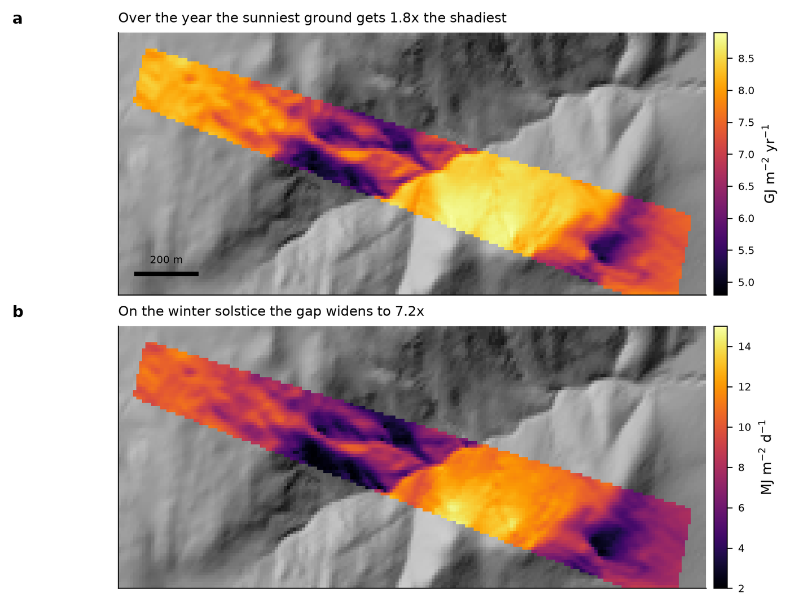
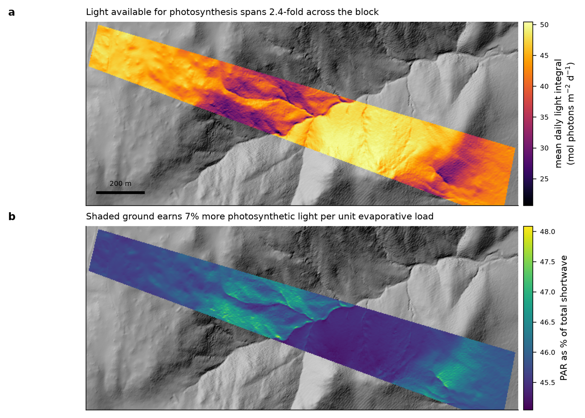

# pyterrainsol

Terrain-corrected solar radiation: beam, diffuse, PAR and daily light integral.

```python
from pyterrainsol import daily_radiation, par_from_components, daily_light_integral

beam, diffuse = daily_radiation(slope_deg, aspect_deg, horizon, sky_view,
                                lat_deg=-36.4355)          # (365, n_cells) MJ/m2/d
par = par_from_components(beam, diffuse)
dli = daily_light_integral(par)                            # mol photons /m2/d
```

## Why not a temperature-based proxy

Hargreaves and similar run on extraterrestrial radiation and temperature range, so
they are structurally blind to aspect: a north slope and a south slope at the same
elevation return identical values. If aspect is meant to drive evaporative demand,
the radiation has to be computed on the actual inclined, shaded surface.

## PAR and shortwave are nearly the same map

A single fixed PAR fraction makes the photosynthesis and evaporation maps identical
in different units. They separate only because diffuse light is spectrally richer in
PAR (~0.60) than direct beam (~0.43), so the split is applied per component. On steep
terrain the resulting PAR share of total shortwave spans only about 0.45–0.48 — real,
physically grounded, and modest. Say so rather than overselling it.

## What terrain actually sorts

On a mid-latitude block, terrain differentiates the radiation load overwhelmingly in
winter. At Avonside the winter solstice spans 7.2-fold across 47 ha while the summer
solstice spans 1.26-fold — so summer differences between paddocks come from water,
not from aspect.

## Worked example — 47 ha in the Snowy Monaro, NSW

Computed on a 3 m LiDAR DEM (51,467 cells) with horizon shading at 32 azimuths.



*Annual total and winter-solstice daily shortwave. Over the year the sunniest ground
receives 1.8 times the shadiest; on the winter solstice the gap widens to 7.2-fold,
while on the summer solstice it is only 1.26-fold. Terrain sorts the energy load
almost entirely in winter.*



*Mean daily light integral (20.7-50.4 mol photons per square metre per day, a 2.4-fold
span) and PAR as a share of total shortwave. Shaded ground earns about 7% more
photosynthetic light per unit of evaporative load -- real, but the two maps remain
about 93% the same picture.*

An animation of all 365 days is held outside the repository for now; `daily_radiation`
returns the full (365, n_cells) array, so any renderer can reproduce it.
