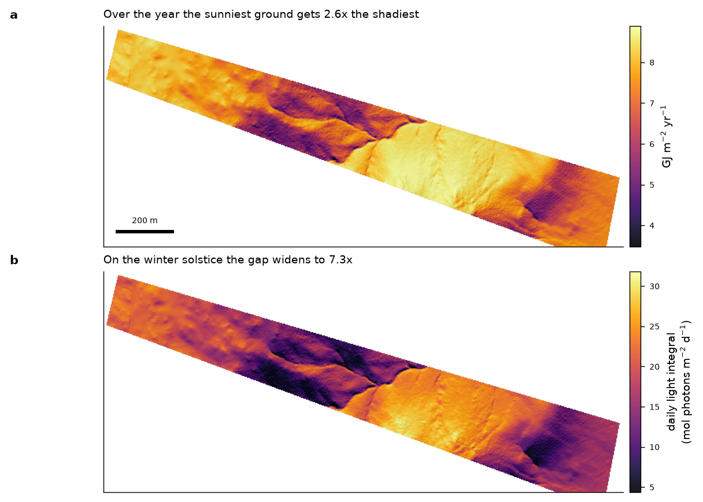

# pyterrainsol

Terrain-corrected solar radiation: beam, diffuse, PAR and daily light integral.

```python
from pyterrainsol import daily_radiation, par_from_components, daily_light_integral

beam, diffuse = daily_radiation(slope_deg, aspect_deg, horizon, sky_view,
                                lat_deg=-36.4355)          # (365, n_cells) MJ/m2/d
par = par_from_components(beam, diffuse)
dli = daily_light_integral(par)                            # mol photons /m2/d
```

Takes slope, aspect, horizon angles and sky view factor — e.g. from
[`pylidarterrain`](https://github.com/jborevitz/pylidarterrain) — and returns daily
shortwave on the inclined, shaded surface.

## Why not a temperature-based proxy

Hargreaves and similar run on extraterrestrial radiation and temperature range, so
they are structurally blind to aspect: a north slope and a south slope at the same
elevation return identical values. If aspect is meant to drive evaporative demand,
the radiation has to be computed on the actual inclined, shaded surface.

## PAR and shortwave are nearly the same map

A single fixed PAR fraction makes the photosynthesis and evaporation maps identical
in different units. They separate only because diffuse light is spectrally richer in
PAR (~0.60) than direct beam (~0.43), so the split is applied per component. The
resulting spread is real but modest. Say so rather than overselling it.

## Worked example — 47 ha in the Snowy Monaro, NSW

Computed on a **3 m** LiDAR DEM (51,467 cells) with horizon shading at 32 azimuths.



*Annual total shortwave (3477–8890 MJ m⁻² yr⁻¹, a 2.6-fold span) and the winter
solstice daily light integral (4.4–31.8 mol photons m⁻² d⁻¹, 7.3-fold). On the summer
solstice the same ground spans only 1.48-fold, 47.5–70.1 mol m⁻² d⁻¹. Terrain sorts
the energy load overwhelmingly in winter — so summer differences between paddocks come
from water, not from aspect.*


*Mean daily light integral (20.7–50.4 mol photons m⁻² d⁻¹, a 2.4-fold span) and PAR as
a share of total shortwave (0.450–0.481). Shaded ground earns about 7% more
photosynthetic light per unit of evaporative load — real, but the two maps remain
about 93% the same picture.*

Resolution matters here: the same calculation on a 10 m grid gives a 1.8-fold annual
span and 1.26-fold in summer, because coarse cells average away the gully walls that
cast the deepest shade. The shaded annual minimum falls from 4841 MJ m⁻² at 10 m to
3477 at 3 m.

An animation of all 365 days is held outside the repository for now; `daily_radiation`
returns the full (365, n_cells) array, so any renderer can reproduce it.
