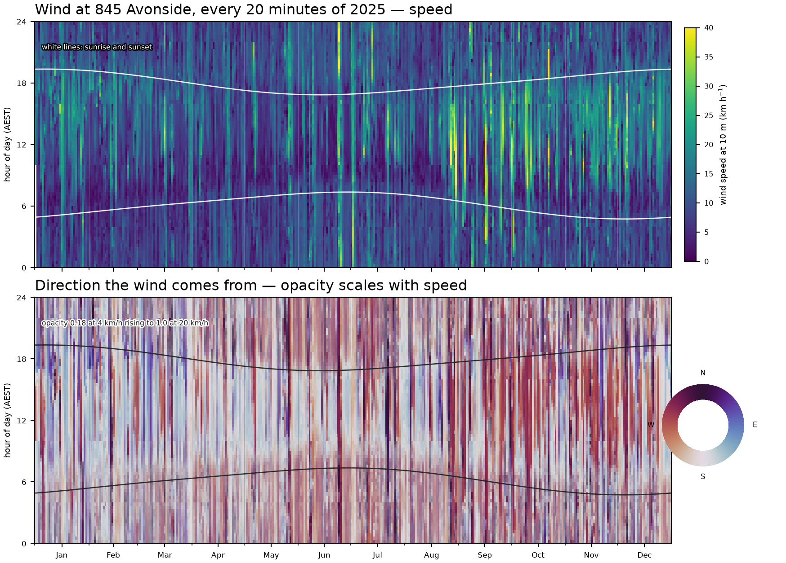
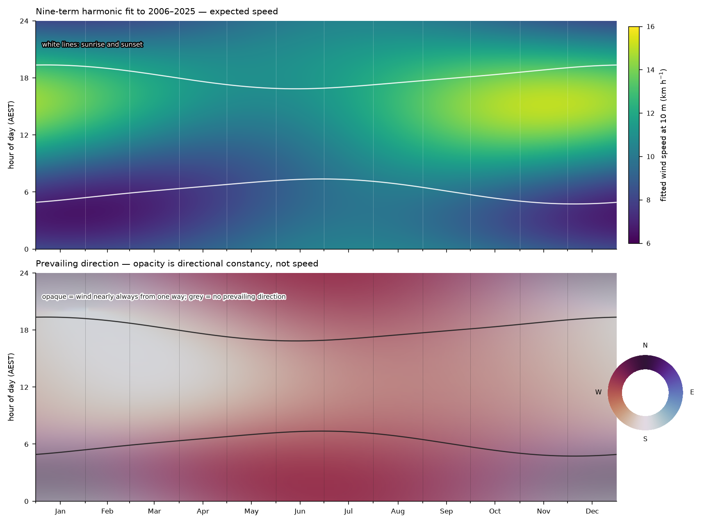
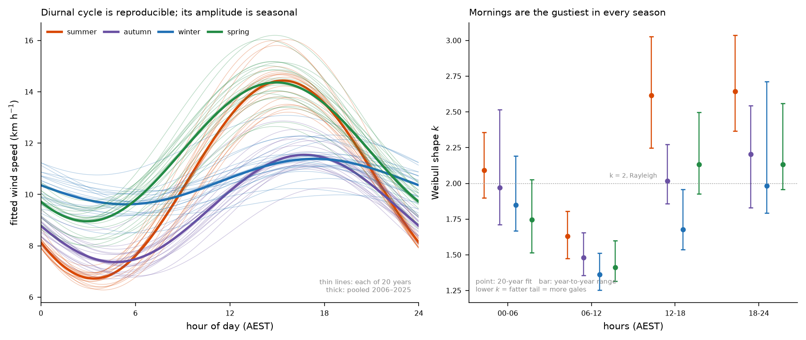
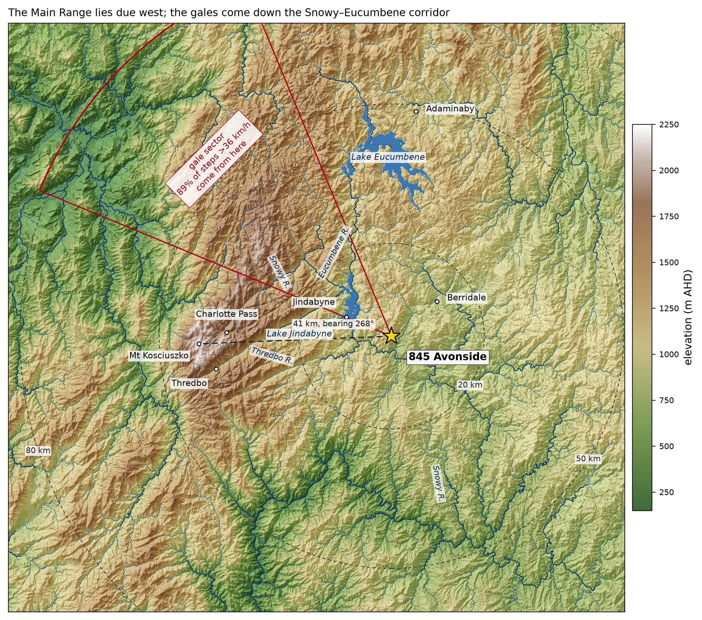
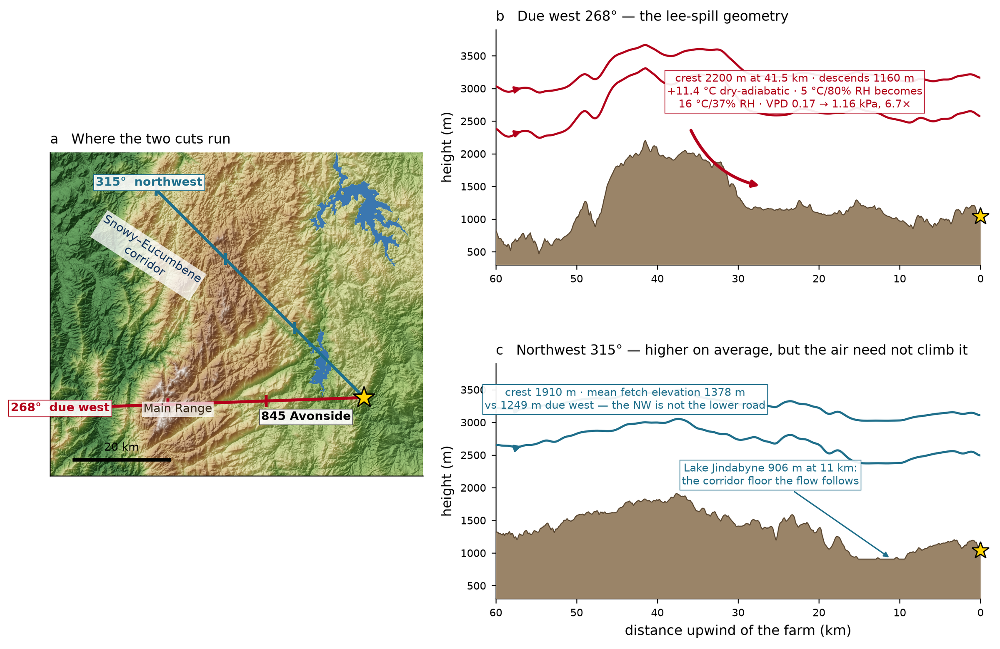
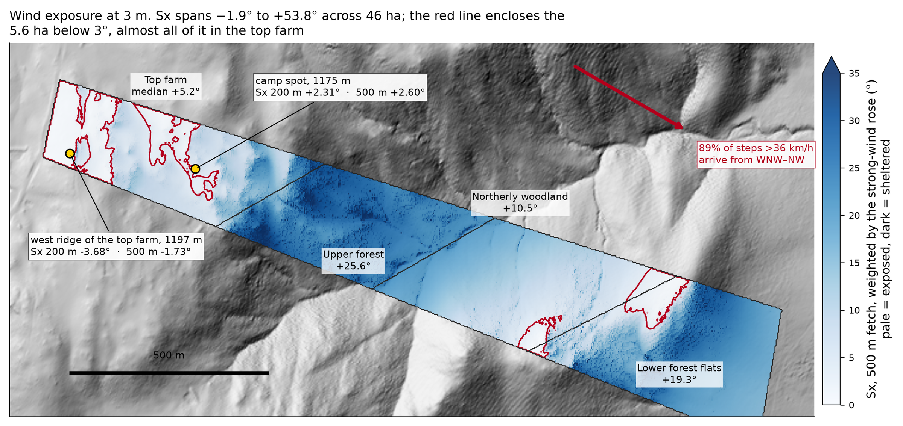
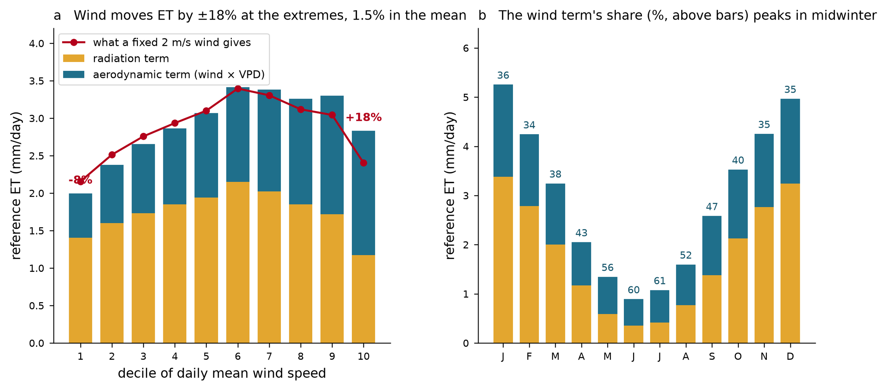
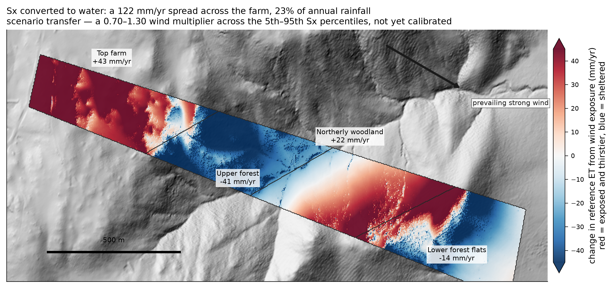
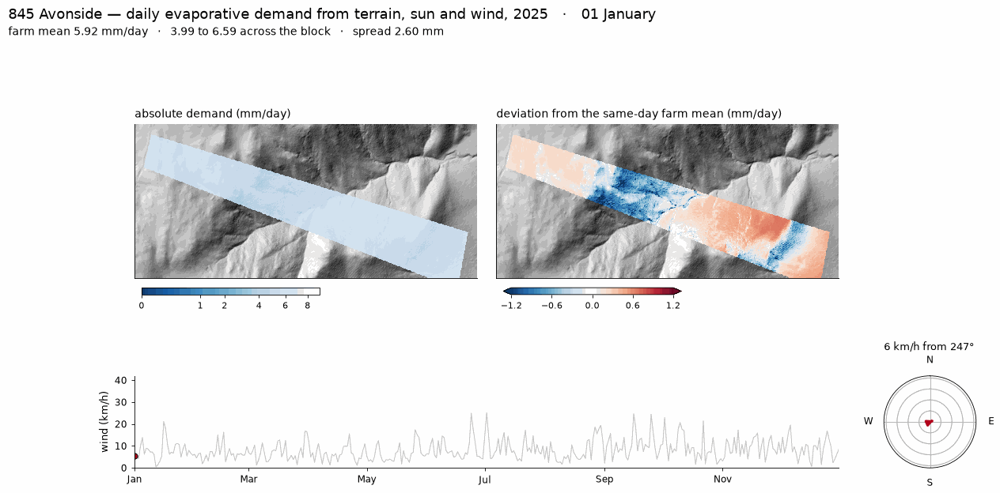
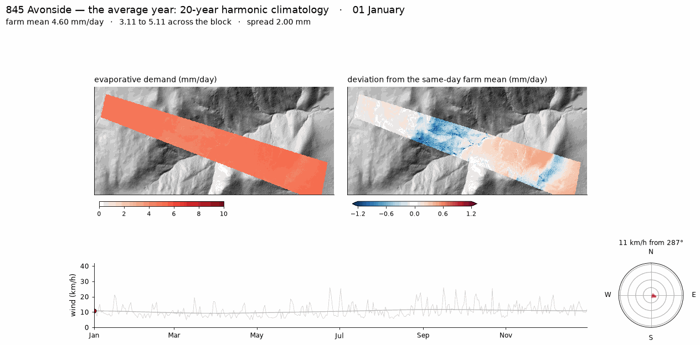

# pyterrainsol

Terrain-corrected solar radiation and the evaporative demand that follows from it:
beam, diffuse, PAR, daily light integral, Priestley-Taylor ET, and the wind
calculations a Penman-Monteith upgrade would need.

```python
from pyterrainsol import (daily_radiation, par_from_components, daily_light_integral,
                          net_longwave, net_radiation, priestley_taylor,
                          speed_direction, roughness_length, fit_harmonic, weibull_fit)

beam, diffuse = daily_radiation(slope_deg, aspect_deg, horizon, sky_view,
                                lat_deg=-36.4355)          # (365, n_cells) MJ/m2/d
par = par_from_components(beam, diffuse)
dli = daily_light_integral(par)                            # mol photons /m2/d

loss = net_longwave(t_min_c, t_max_c, clearness)           # (365,)  -- not per cell
et   = priestley_taylor(net_radiation(clearness * (beam + diffuse), loss),
                        t_mean_c[:, None], elevation_m)    # (365, n_cells) mm/d
```

Takes slope, aspect, horizon angles and sky view factor — e.g. from
[`pylidarterrain`](https://github.com/jborevitz/pylidarterrain) — and returns daily
shortwave on the inclined, shaded surface.

## What it found at 845 Avonside

46.3 ha in the Snowy Monaro, NSW, 888–1197 m, on a 3 m LiDAR DEM with horizon
shading at 32 azimuths. Rainfall averages **537 mm/yr** over 2006–2025 against
**1043 mm/yr** of FAO-56 reference ET — a mean deficit near 506 mm. Read every
number below against that.

### Terrain sorts the energy load almost entirely in winter


*Annual total shortwave spans 3477–8890 MJ m⁻² yr⁻¹, a 2.6-fold span; the winter
solstice daily light integral spans 4.4–31.8 mol photons m⁻² d⁻¹, 7.3-fold. On the
summer solstice the same ground spans only 1.48-fold, 47.5–70.1 mol m⁻² d⁻¹.*

Summer differences between paddocks therefore come from water, not from aspect.
That is the single most useful thing the radiation model says about managing here.


*PAR as a fraction of total shortwave spans only 0.450–0.481. Shaded ground earns
about 7% more photosynthetic light per unit evaporative load, but the two maps
remain roughly 93% the same picture.*

### Demand swings far harder than light

The partition term Δ/(Δ+γ) runs **0.483 in July to 0.680 in January**, a 1.41-fold
swing; light swings 3.7-fold. Demand swings much harder than either, because the
longwave loss of 4.4–4.8 MJ m⁻² d⁻¹ is nearly constant — **in June only 0.87 of
7.2 MJ m⁻² d⁻¹ survives as net radiation.**


*Incoming shortwave, every day, 3 m grid, clear-sky geometry scaled by a monthly
clearness index of 0.74–0.80. The boundary is drawn over the full catchment rather
than clipped to it. The GIF steps every 6th day to stay under 6 MB; daily version:
[avonside_light_year.mp4](https://raw.githubusercontent.com/jborevitz/pyterrainsol/main/docs/avonside_light_year.mp4).*


*The same days as potential ET — **blue is where water stays, pale is where it
leaves**. January bleaches almost white; July holds deep blue, the north-facing
slopes its only pale patches. Square-root colour scale, because midwinter demand is
0.1–1 mm/day against a summer 5–6. Daily version:
[avonside_et_year.mp4](https://raw.githubusercontent.com/jborevitz/pyterrainsol/main/docs/avonside_et_year.mp4).*


*Potential ET spans **318–1103 mm/yr**, median 900. The histogram is **bimodal**,
not a gradient: aspect sorts the block into two populations. On slopes over 20°,
north-facing ground demands **1071 mm/yr against 599 for south-facing — a 472 mm
gap, 88% of a year's rainfall.***

A flat unobstructed cell at 1040 m gives 953 mm/yr, which SILO's own products at
this location bracket — `evap_comb` 972, `et_short_crop` 1043 — and ours sits lower
in the way a higher, cooler cell should.

### By management part

The three figures above are WorldClim-forced. Recomputing on SILO daily data, with
per-cell temperature lapsed at 6.5 °C/km from SILO's 861 m grid point, shifts the
farm range to **310–1075 mm/yr, median 862**; the drop is the lapse correction.
Clearness comes out at 0.762 against WorldClim's 0.760.

| part | area | median grade | % north-facing | potential ET |
|---|---|---|---|---|
| Top farm | 11.6 ha | 14% | 22% | 899 mm/yr |
| Upper forest | 10.2 ha | 48% | 1.5% | **653 mm/yr** |
| Northerly woodland | 11.8 ha | 30% | 85% | **1018 mm/yr** |
| Lower forest flats | 12.7 ha | 29% | 5.5% | 809 mm/yr |

**365 mm/yr separates the thirstiest part from the least thirsty — 68% of annual
rainfall — and the two extremes share a boundary.** Parts are defined in
[`pylidarterrain`](https://github.com/jborevitz/pylidarterrain).

### Two wind regimes, pushing water opposite ways



*2025 at 20-minute resolution: 365 days across, 72 steps of the day up, local AEST.*



*The nine-term harmonic fit to 2006–2025 on the same axes, opacity by directional
constancy (0.00 to 0.81). The steadiest wind of the year is midwinter before dawn
from 293°; the least steady is a summer evening, which greys out because there is
genuinely no prevailing direction then. Fitted speed spans 6.6–15.1 km/h against an
observed 0–70.2 — a climatology predicts the expectation, never the day.*

The dark spring columns are a dry, fast north-westerly: of steps above 36 km/h,
**89% come from WNW through NNW**. The pale pre-noon wedges from December to March
are a slow, humid easterly rotating westerly by afternoon, a daily rotation absent
in June and July. The first raises real demand above what this package reports, the
second lowers it — so **the model's error changes sign with the season.**



The nine-term model explains **10.0% of speed variance over 2006–2025**; climatology
sd is 2.01 km/h against a residual of 6.02, so synoptic weather is three times the
amplitude of the whole annual plus daily cycle. **2025 alone gave 15.3% and ranks
first of twenty on both fit and annual amplitude** — calibrating on it would have
been calibrating on an outlier.

| quantity | pooled | year-to-year sd | verdict |
|---|---|---|---|
| mean speed | 10.56 km/h | 0.36 | solid |
| diurnal amplitude | 2.33 km/h | 0.19 | solid |
| diurnal peak hour | 15.7 h AEST | 0.26 h | solid |
| diurnal amplitude, midsummer | 3.86 km/h | 0.40 | solid |
| annual amplitude | 1.10 km/h | **0.40** | weak |
| annual peak day | day 275 | **28 days** | do not interpret |

Gust shape held up where the harmonics did not. Per-bin Weibull `k` varies year to
year by only 0.07–0.24, and **mornings carry the lowest `k` in all four seasons**
(1.36–1.63). Summer afternoons have a *higher* scale than spring mornings, 15.7
against 12.0 km/h, and yet **six times fewer hours above 30 km/h** — 0.44% against
2.62% — because `k` is 2.61 against 1.41.

Median u50/u10 is 1.515, inverting to **z0 ≈ 0.44 m**, ten times rougher than short
grass. By sector z0 runs 0.296 m (from the south) to 0.449 m (northwest). The ratio
is 1.473 at midday and 1.573 at night, which would invert to 0.33 and 0.60 m — the
ground does not get rougher after dark, that is the stable nocturnal boundary layer.

Parameters: [`data/wind_weibull_20y.csv`](data/wind_weibull_20y.csv) and
[`data/wind_harmonic_by_year.csv`](data/wind_harmonic_by_year.csv).

### Where the wind comes from, and why the mountains are not in the model



*The Main Range is 41.5 km away on a bearing of 268 degrees, almost due west --
and so sits **outside** the 292.5-337.5 degree sector that carries 89% of the
steps above 36 km/h. The gales look instead up the Snowy-Eucumbene corridor, a
1000-1200 m trench between the range and the Monaro tableland. Tracing the Snowy
from Charlotte Pass with a D8 flow grid: 40.9 km to Lake Jindabyne at 906 m,
then a straight 15.8 km run to the farm, so air following that line arrives from
**314 degrees** against a sector centre of 315. Nothing was tuned to produce
that.*



*Due west the air would have to cross a 2203 m crest and descend 1160 m, which
warms it 11.4 C dry-adiabatically: a 5 C, 80% RH parcel arrives at 16 C and 37%,
and its vapour pressure deficit goes from 0.17 to 1.16 kPa -- **6.7 times the
drying power**. That is a lee-wave spill, and it is what a resident means by
feeling the mountains. The northwest ray is **not** the low road, though: mean
elevation 1378 m against 1249 m due west.*

**All of this is already in the forcing.** BARRA-C2 runs at 4.4 km, which
resolves the corridor, and hands us wind at the farm pixel with the channelling
included. SILO's temperature and humidity are the air mass that actually
arrived, foehn warming and all. Re-deriving the mountain effect here would be
re-deriving, badly, what the reanalysis already did. So this package reads the
regional terrain to *explain* the wind, never to *predict* it.

What a 4.4 km reanalysis cannot contain is the last 500 m. That part is ours.



*Sx -- the upwind horizon angle over a 500 m fetch, weighted by the strong-wind
rose -- on the 3 m grid. It spans **-1.9 to +53.8 degrees** across 46 ha. By
part: top farm **+5.2**, northerly woodland +10.5, lower forest flats +19.3,
upper forest **+25.6**. The west-facing ridge of the top farm at 1197 m reads
**-1.73** and the camp spot **+2.60** -- ground where the horizon falls away
upwind. 5.6 ha, almost all of it in the top farm, sits below 3 degrees.*

Measured, not assumed: **every bit of that shelter comes from within 1 km.**
Averaged over the gale sector the horizon angle over a 60 km fetch is 18.38
degrees, and the terrain within 1 km alone gives 18.38 -- the same number. The
Main Range contributes 1.4. A long fetch is for air-mass history, not shelter.



*What the wind is worth, from a FAO-56 decomposition on SILO forcing with BARRA
wind: 1065 mm/yr against SILO's own et_short_crop of 1043, daily r = 0.991. The
radiation term carries 637 mm/yr and the aerodynamic term 427. Replacing the
real wind with a fixed 2 m/s moves the **annual** total by only 15 mm -- but by
-8% on the calmest decile of days and **+18% on the windiest**, and +23% on the
windiest 5%. The wind term's share peaks in **midwinter at 61%**, when net
radiation has collapsed and air movement is nearly all the demand there is.*

**The honest gap.** Sx is in degrees of **arc**, and it is pure geometry -- the
same quantity as a solar horizon angle, computed by the same code. For the sun
that geometry *is* the physics: when solar elevation drops below the horizon
angle the beam is blocked, and trigonometry alone converts degrees to MJ/m2. Air
is a fluid with inertia. It is not blocked below a threshold angle; it separates,
reattaches, and can accelerate over a crest. There is no cosine law taking Sx to
m/s, that step is empirical, and this package does not yet make it. For scale,
reference ET responds at **92 mm/yr per m/s** at 2 m around the 20-year mean, and
a uniform x0.7 against x1.3 spans 1000 to 1121 mm/yr. The way to close it here is
two anemometers -- one on the west ridge at -1.7, one in the upper forest at
+25.6 -- and a measured ratio.


### Sx in millimetres, and a year of it



*Converting Sx to a wind multiplier is the one step with no physics in it, so
this is a declared scenario rather than a calibration: multiplier =
clip(1 + 0.0205 x (median Sx - Sx), 0.70, 1.30), anchored on the farm-median Sx
so the farm-mean multiplier stays at 1.0 and BARRA's grid wind is redistributed
rather than changed. On that basis reference ET spans **1000 to 1121 mm/yr**
from exposure alone -- a 122 mm spread, **23% of annual rainfall**.*

**Wind reinforces the radiation pattern instead of compensating for it.** Across
the four parts the correlation between radiation-driven ET and the Sx delta is
**+0.84**, the ranking does not change, and the between-part spread widens from
365 to **427 mm/yr**. The driest part gets drier.



*2025, day by day, with the real weather: SILO temperature and humidity, BARRA
daily-mean wind, terrain-corrected radiation on the 3 m grid with 32-azimuth
horizon shading. Left is absolute demand on a linear 0-10 mm/day scale, white to red; right is
the deviation from that same day's farm mean, which is where the spatial story
lives. The scale is deliberately linear and shared between both movies: a
square-root ramp stretched the near-zero winter values and flattened the summer
days that actually move the water. Farm-mean demand runs
**0.22 to 8.01 mm/day** and totals **970 mm**. Every 6th day; the daily version
is [avonside_et_wind_2025.mp4](https://raw.githubusercontent.com/jborevitz/pyterrainsol/main/docs/avonside_et_wind_2025.mp4).*

The number that justifies the 3 m grid: the max-to-min spread across the block
on a given day runs 0.47 to 3.75 mm/day, median 1.93, and **on 94% of days that
spread is larger than the change from yesterday to today**. A point gauge would
be tracking the smaller of the two signals. Splitting the farm-mean series into
a smooth seasonal curve plus a remainder puts **47% of the variability in
weather rather than season**.



*The same model driven by a 3-harmonic fit to twenty years of forcing — the year
the site has on average, with the weather removed. **904 mm** against 970 for
2025, so 2025 ran 7% high, consistent with the point record placing it 5% above
the twenty-year mean and 6th of 20. Daily version:
[avonside_et_climatology.mp4](https://raw.githubusercontent.com/jborevitz/pyterrainsol/main/docs/avonside_et_climatology.mp4).*

Per-cell annual demand in the average year spans **477 to 1096 mm**. By part:
upper forest 753, top farm 896, lower forest flats 901, northerly woodland
1045 mm/yr.

Two cautions the fitting earned. Wind speed must be fitted as a **scalar**:
fitting the u and v components and taking the magnitude gives a seasonal curve
of 0.2-6.5 km/h against a true mean near 10.5, because opposing directions
cancel in a vector mean. Components are right for the arrow, scalar for
Penman-Monteith. And the seasonal cycle is weak in everything but temperature —
the harmonic fit explains 69% of daily maximum temperature and 63% of minimum,
but only 4.5% of clearness and 3.8% of wind speed, so the smooth year is almost
entirely a temperature-and-radiation story.


## Data

`data/` holds the forcing used above, each with the script that regenerates it:
twenty years of BARRA-C2 wind at 10 m and 50 m on 20-minute steps, and twenty years
of SILO daily climate including vapour pressure deficit. See
[`data/README.md`](data/README.md) for keys, provenance and the traps.

## Methods

The conventions this package enforces, the traps it exists to prevent, and what it
deliberately does not do are in **[`docs/methods.md`](docs/methods.md)**.

Methods and results are kept apart on purpose. The methods travel to any site and
will be re-checked against new ground and simulated data; the findings above are one
47 ha property in the Snowy Monaro, some of them specific to it and some likely to
generalise. Either can then be argued with without disturbing the other.
