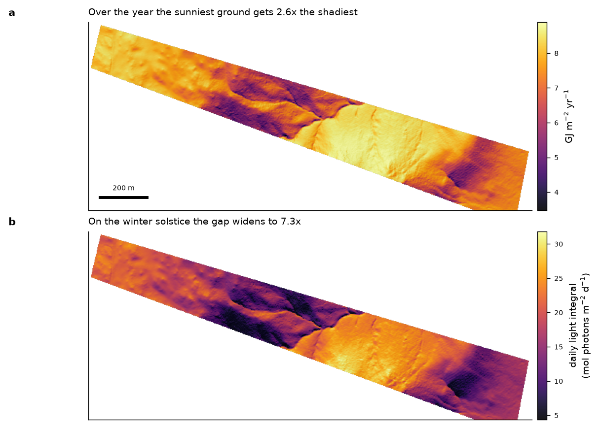
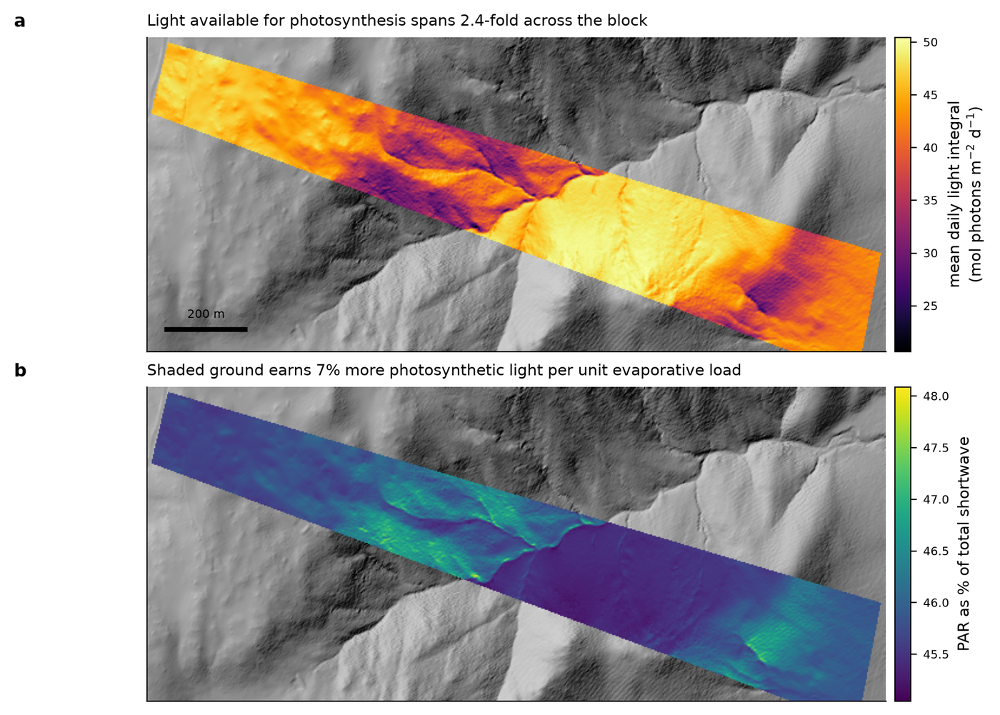
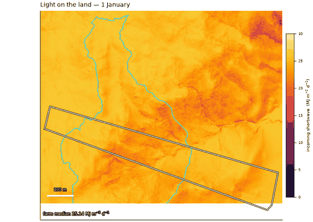
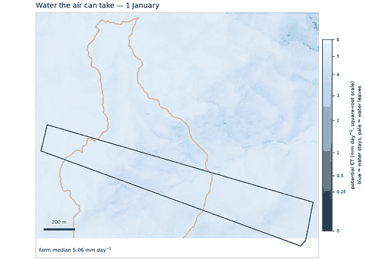
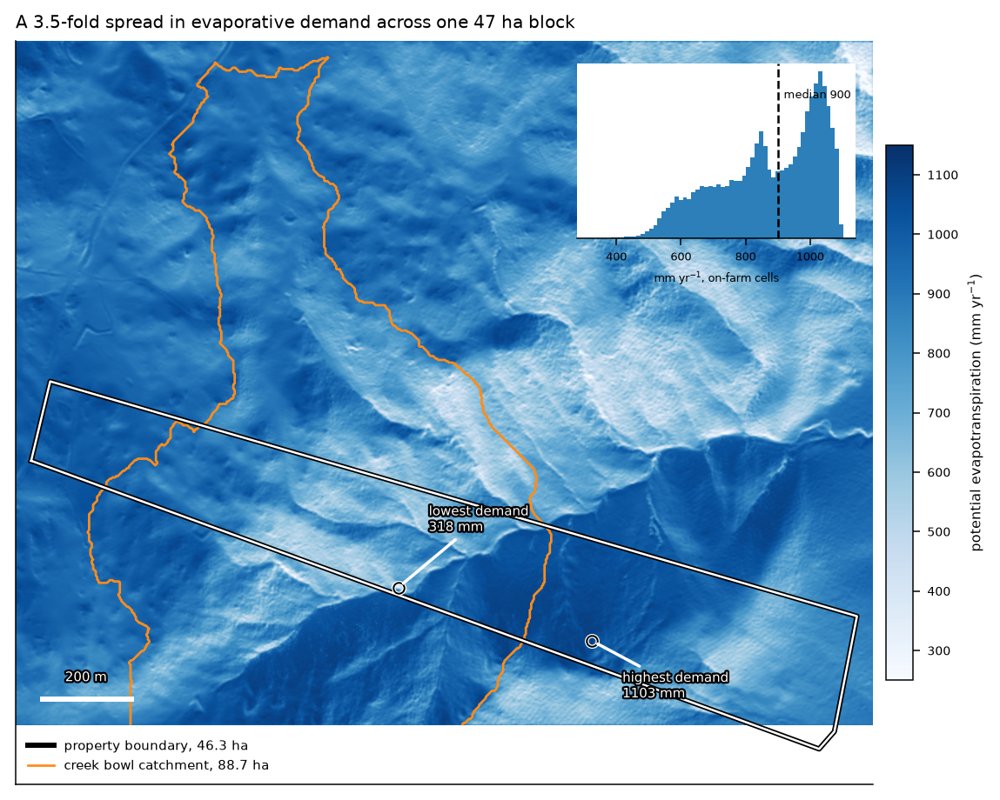

# pyterrainsol

Terrain-corrected solar radiation: beam, diffuse, PAR and daily light integral.

```python
from pyterrainsol import (daily_radiation, par_from_components, daily_light_integral,
                          net_longwave, net_radiation, priestley_taylor)

beam, diffuse = daily_radiation(slope_deg, aspect_deg, horizon, sky_view,
                                lat_deg=-36.4355)          # (365, n_cells) MJ/m2/d
par = par_from_components(beam, diffuse)
dli = daily_light_integral(par)                            # mol photons /m2/d

loss = net_longwave(t_min_c, t_max_c, clearness)           # (365,)  -- not per cell
et   = priestley_taylor(net_radiation(clearness * (beam + diffuse), loss),
                        t_mean_c[:, None], elevation_m)    # (365, n_cells) mm/d
```

Takes slope, aspect, horizon angles and sky view factor — e.g. from
[`pylidarterrain`](https://github.com/jborevitz/pylidarterrain) — and returns daily
shortwave on the inclined, shaded surface.

## Why not a temperature-based proxy

Hargreaves and similar run on extraterrestrial radiation and temperature range, so
they are structurally blind to aspect: a north slope and a south slope at the same
elevation return identical values. If aspect is meant to drive evaporative demand,
the radiation has to be computed on the actual inclined, shaded surface.

## PAR and shortwave are nearly the same map

A single fixed PAR fraction makes the photosynthesis and evaporation maps identical
in different units. They separate only because diffuse light is spectrally richer in
PAR (~0.60) than direct beam (~0.43), so the split is applied per component. The
resulting spread is real but modest. Say so rather than overselling it.

## Worked example — 47 ha in the Snowy Monaro, NSW

Computed on a **3 m** LiDAR DEM (51,467 cells) with horizon shading at 32 azimuths.



*Annual total shortwave (3477–8890 MJ m⁻² yr⁻¹, a 2.6-fold span) and the winter
solstice daily light integral (4.4–31.8 mol photons m⁻² d⁻¹, 7.3-fold). On the summer
solstice the same ground spans only 1.48-fold, 47.5–70.1 mol m⁻² d⁻¹. Terrain sorts
the energy load overwhelmingly in winter — so summer differences between paddocks come
from water, not from aspect.*



*PAR as a fraction of total shortwave spans only 0.450–0.481 across the block.
Shaded ground earns about 7% more photosynthetic light per unit of evaporative load,
but the two maps remain roughly 93% the same picture.*

## From light to evaporative demand

Radiation is a map; temperature is a clock. The Priestley-Taylor partition term
Δ/(Δ+γ) is the fraction of available energy that leaves the surface as water
rather than as hot air, and because saturation vapour pressure follows
Clausius-Clapeyron it climbs steeply with temperature. At Avonside it runs from
**0.483 in July to 0.680 in January** — a 1.41-fold swing. On any given day every
cell on the block shares that value to within the 2 °C the 309 m elevation range
buys, so it varies in time and barely in space, which is the mirror image of
radiation. That is why a 10 km climate product costs nothing here: it only ever
supplies the part that does not vary across the farm.

Altitude helps the wrong way. At 1040 m the pressure is 89.6 kPa, so γ is 0.0596
rather than the sea-level 0.0674, raising the evaporating fraction of any given
energy input by about three percentage points year-round.

### Two years in the life of one hillside



*Incoming shortwave, every day of the year, 3 m grid. Clear-sky geometry scaled
by a monthly clearness index of 0.74–0.80 (annual mean 0.760) derived from
WorldClim's observed radiation climatology. The property boundary is drawn over
the full catchment rather than clipped to it. Full 365-frame version:
[`docs/avonside_light_year.mp4`](docs/avonside_light_year.mp4).*



*The same days as potential evapotranspiration in mm. Note the **square-root colour
scale**: midwinter demand is 0.1–1 mm/day against a summer 5–6, and on a linear
scale the whole of winter is a blank screen. Full version:
[`docs/avonside_et_year.mp4`](docs/avonside_et_year.mp4).*



*The year summed into one map. **Blue is where water stays, pale is where it leaves** - the ramp is inverted relative to the movie above, because an annual total is read as a map of retention rather than of flux. Potential ET spans **318-1103 mm/yr** across 46.3 ha,
median 900, interquartile range 758-1012. The on-farm histogram is **bimodal**, not a
smooth gradient: aspect sorts the block into two populations rather than a continuum.
On slopes steeper than 20 degrees, north-facing ground demands **1071 mm/yr against
599 for south-facing - a 472 mm gap**, which at this site is most of a year's rainfall.
Two paddocks the same size, the same soil and the same sky are being asked for very
different amounts of water.*

The pair is worth watching together because they are not the same movie. Farm-median
light swings **3.7-fold** between summer and winter; demand swings far harder, because
the longwave loss of 4.4–4.8 MJ m⁻² d⁻¹ is a near-constant subtraction. In June only
**0.87 of 7.2 MJ m⁻² d⁻¹** survives as net radiation. Multiply what is left by a
partition term that has itself fallen by a third and midwinter demand nearly vanishes.

Over the block, potential ET runs **318–1103 mm/yr, median 900**; a flat unobstructed
cell at 1040 m gives 953 mm/yr. Watch July in the second movie: the north-facing
slopes are the only ground losing appreciable water, which is the same effect that
gives those faces an early spring.

## What this does not do

- **No wind.** Priestley-Taylor has no aerodynamic term; α = 1.26 absorbs a typical
  advection contribution. That is defensible when net radiation dominates and weakest
  exactly where this model puts its minimum — midwinter, when Rn is near zero but the
  air still moves. Treat the winter floor as a lower bound. Wind enters properly only
  through Penman-Monteith, which needs humidity and wind speed this package does not
  take.
- **No weather.** A clear-sky model scaled by a monthly clearness index has no
  individual cloudy days, so these are climatological days, not a particular year.
- **No water limit.** This is demand, not actual evapotranspiration — an upper bound
  on what the atmosphere can take from a well-watered surface. What it does take is a
  soil water question and belongs in a different package.
- **Humidity is inferred**, as saturation vapour pressure at the daily minimum
  temperature, the FAO-56 fallback when nothing is measured.

Climate inputs are WorldClim 2.1 monthly normals at 5 arc-minutes — roughly 10 km, a
single cell over this farm, and a 1970–2000 baseline.
